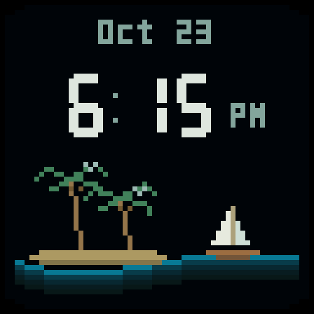

# DeskDisplay

Custom ESP-IDF 5.5.2 / LVGL 9.3 firmware for a Waveshare ESP32-S3-RGB-Matrix
(32 MB flash, 16 MB PSRAM) driving one 64 x 64 HUB75 panel.

Two clock faces share the RTC-backed time. The original cyan ribbon clock keeps
its layout and animation. The new island face uses a small mixed-case date,
rounded clock digits with inline AM/PM, two coconut palms, a gently rocking
white-sailed boat, and tiny birds that leave and return every 20–30 seconds.
Calendar, weather, and timer integrations are future work.



## Build and use

To explore designs on your computer before building firmware, open
[`preview/index.html`](preview/index.html), or run `.\scripts\preview.ps1` and
visit <http://127.0.0.1:8765>. Face Lab offers six animated 64×64 concepts,
layout and color controls, saved variations, a shortlist, PNG snapshots, and
exportable build briefs. See the [preview guide](preview/README.md).

Open this repository root in VS Code. On a fresh checkout, install Git and Python
3.11, then run these commands from the repository root:

```powershell
.\scripts\setup.ps1
.\scripts\idf.ps1 build
.\scripts\idf.ps1 -p COM4 flash
.\.tools\host-python\Scripts\python.exe scripts/device.py sync
```

The local tools are already installed in this workspace. Use `Ctrl+Shift+B` to
build, or **Terminal > Run Task** for flashing, monitoring, clock sync, and the
speaker test. Close the serial monitor before another task uses the USB port.

- Tap **BOOT** to switch between the original clock and island face.
- Hold **BOOT** for one second to play the speaker test.
- Press **RST** to return to the clock at 25% brightness.

## Project layout

```text
main/
  main.c              Startup, USB commands, and button handling
  board/              Display, audio, RTC, and board pin definitions
  ui/                 LVGL screens and animations
scripts/              Toolchain setup, builds, and USB controls
docs/
  firmware.md         Configuration, controls, and development notes
  hardware/           Board schematic and mechanical dimensions
  images/             Captures of the custom display modes
.vscode/              Shared build tasks and editor settings
CMakeLists.txt        ESP-IDF project entry point
sdkconfig.defaults   Board and library configuration
partitions.csv       Flash partition layout
dependencies.lock    Resolved component versions
```

ESP-IDF expects `main/` and the project configuration at the repository root.
Downloaded tools (`.tools/`), build output (`build/`), managed components, and
runtime configuration stay local and are hidden in the VS Code Explorer.

See the [firmware guide](docs/firmware.md) for USB commands, clock setup, speaker
volume, hardware references, and extension points.

Select a face through USB:

```powershell
.\.tools\host-python\Scripts\python.exe scripts/device.py mode island
.\.tools\host-python\Scripts\python.exe scripts/device.py mode clock
```

## Upstream references

Board wiring and hardware documentation originate from
[Waveshare's ESP32-S3-RGB-Matrix repository](https://github.com/waveshareteam/ESP32-S3-RGB-Matrix).
The project retains the upstream [Apache 2.0 license](LICENSE).
Managed components retain their respective licenses.
